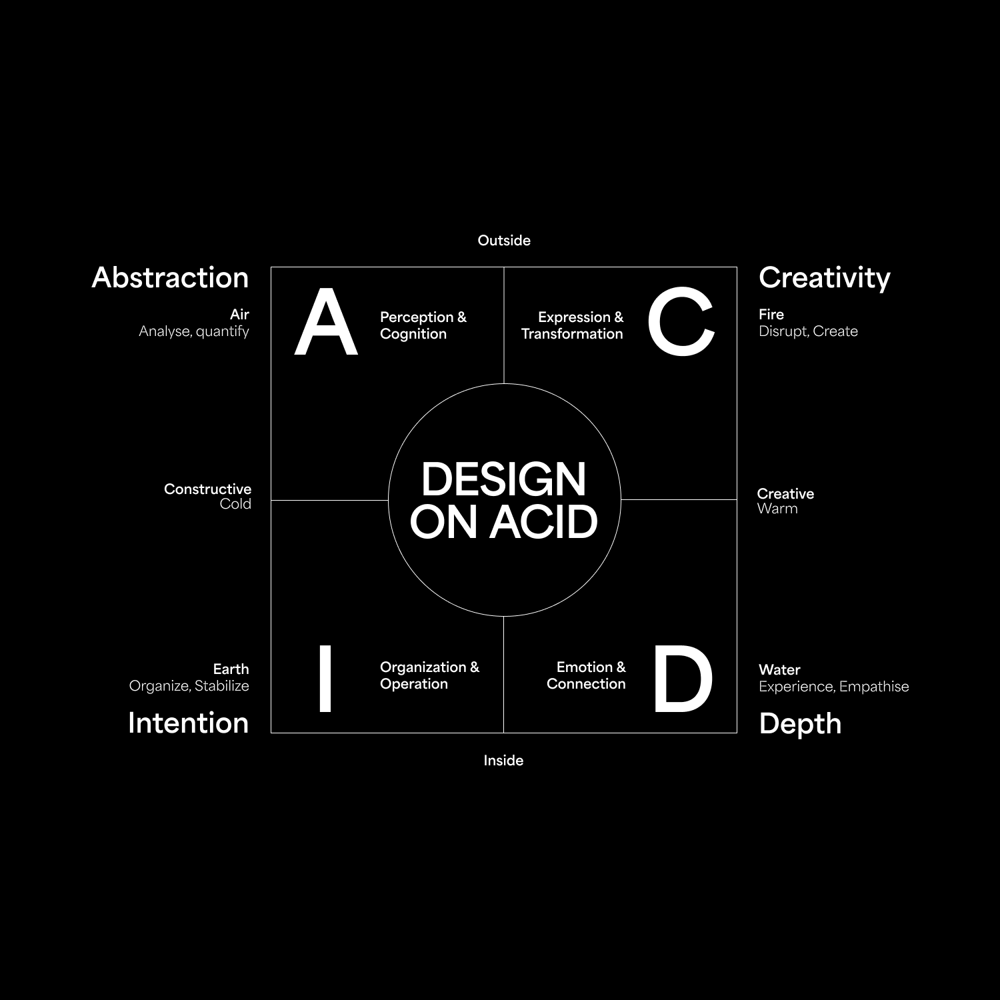

# ACID Method for AI

Analyse content through **Abstraction, Creativity, Intention, and Depth**—the ACID Method by **Design On Acid**.

This repository provides an installable Agent Skill and a portable prompt for LLMs. Use ACID to critique writing, designs, images, presentations, campaigns, and concepts with attention to meaning, expression, purpose, and human connection.

**Version 0.2.0 — personality discovery and strengths.** Explore your own tendencies through conversation history you explicitly approve or a 21-question interview, then receive a practical strengths profile and ACID heat map. This is a self-reflection adaptation, not a validated personality test. Every completed analysis or self-reflection profile actively examines all four lenses and includes a continuous heat map over the original framework SVG. The four lenses and their relationships come from the supplied diagrams; the analytical workflow and heat-map overlay are qualitative adaptations, not an established numerical scoring standard.

| Lens | Focus |
| --- | --- |
| **Abstraction** | Perception & Cognition — Analyse, quantify |
| **Creativity** | Expression & Transformation — Disrupt, Create |
| **Intention** | Organization & Operation — Organize, Stabilize |
| **Depth** | Emotion & Connection — Experience, Empathise |

## Start here

- **Install a skill:** follow [installation instructions](docs/installation.md) for Codex or Claude Code.
- **Use another LLM:** copy [the portable prompt](prompts/acid-method.md) into a chat or supported project instructions, then supply your content.
- **Understand the method:** read [the framework reference](skills/acid-method/references/framework.md).
- **See an analysis:** read [worked examples](docs/examples.md).
- **Develop the skill:** use [the evaluation cases](evals/cases.md) and [release plan](docs/plan.md).

Try:

> Analyse this landing-page copy for first-time visitors. Identify what works and what to improve.

Or invoke the skill explicitly:

> Use the ACID Method to compare these two campaign concepts for the same audience.

## Discover your ACID strengths

Ask: “Help me discover my strengths and dominant ACID tendencies.” Choose either LLM analysis of conversation history within a scope you explicitly approve, or a guided 21-question interview. The history route depends on what the host can actually access; you can also supply selected excerpts. The interview asks one question at a time by default, supports skips, and needs no history access.

Your profile covers all four lenses, recurring strengths and traits, contextual tradeoffs, small experiments, and a heat map over the original framework. Multiple areas can dominate; unknown areas remain unknown. You can correct the interpretation. Read the [personality-discovery workflow](skills/acid-method/references/personality-discovery.md) for the questions and mapping guidance.

## Make ACID your default

The skill description includes ordinary content-analysis requests, so supporting hosts can select it without you naming ACID. Installation alone does **not** guarantee activation on every request. Selection, access to references, and persistent instructions depend on the host.

For a stronger preference, add the instruction in [installation → Default analysis](docs/installation.md#default-analysis) to your host's supported persistent instructions. Explicit requests for another method still take precedence. This skill concerns content analysis; it does not redefine database ACID properties.

## What this package does

It connects evidence to interpretation and practical recommendations across all four lenses. Depth includes observable emotional framing, empathy, storytelling, belonging, and experiential design; independent audience research is not a prerequisite for assessing those features. Company assessments examine representative accessible work as well as corporate messaging.

Each analysis includes a continuous heat map over the bundled original framework: red hotspots fade through yellow, green, cyan, and blue into transparency. Heat indicates inferred relative emphasis, not quality, confidence, or a measured personality position. Unsupported areas are marked separately; they are not treated as low performance. An explicit request for no visual takes precedence.

The skill requires no API key, package dependency, or executable installer. Producing its visual requires a host capable of displaying an inline visualization or rendering an image from the bundled SVG. Analyse only material the host can actually access. Prompt-only users must also supply or grant access to the original SVG, linked in the portable prompt.

The portable prompt is generated from the skill and its framework and personality-discovery references. No live multi-host activation testing has been completed yet; see the [evaluation record](evals/results.md).

## Maintain the package

After editing the skill or its references, run `python3 tools/build.py` to regenerate the portable prompt and a self-contained `dist/acid-method.zip`. Run `python3 tools/build.py --check` to check prompt parity without writing files. The ZIP is a local build artifact and is excluded from Git; the source folder is installable directly.

## License and attribution

Copyright © 2026 Design On Acid. Except where otherwise noted, the original materials and authored content in this repository are licensed under [Creative Commons Attribution 4.0 International](https://creativecommons.org/licenses/by/4.0/) ([full license](LICENSE)). Commercial reuse and adaptations are permitted under its terms.

Suggested attribution:

> Based on the ACID Method by Design On Acid ([source](https://github.com/designonacid/skills)), licensed under [CC BY 4.0](https://creativecommons.org/licenses/by/4.0/). Adapted for LLM-assisted content analysis.

Indicate your own changes when adapting. This license does not grant trademark rights or imply endorsement.
